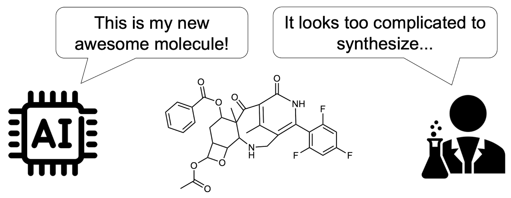

# RxnFlow: Synthesis-aware drug design with GFlowNets



Official implementation of RxnFlow, a generative model for synthesis-aware drug design. RxnFlow uses a generative flow network (GFlowNet) to generate diverse, high-reward molecules.

**Updates:**

- **2026.10.11 — RxnFlow v2 released.** 
  - This update incorporates our in-house model **Hyper Screening X (HSX)**, developed in collaboration with [HITS](https://hits.ai/index_en.html) and [eMolecules](https://www.emolecules.com/). Together with wet-lab collaborators at Yonsei University, we identified two first-in-class lead compounds targeting an SLC1A5 variant.

Papers: [RxnFlow (ICLR 2025)](https://arxiv.org/abs/2410.04542) · [HSX (preprint)](https://www.biorxiv.org/content/10.64898/2026.10.01.755933)

## Installation

RxnFlow requires Python 3.10 or later.

```bash
git clone https://github.com/SeonghwanSeo/RxnFlow
cd RxnFlow/
pip install -e .
```

## Quick start

Start with the supplied [example SMILES file](data/building_blocks/example_5k.smi), which contains 5,000 ZINC building blocks.

### Prepare a synthesis environment

To prepare a synthesis environment, you need a building-block library and reaction templates. Three template sets are available in `data/templates/`:

- `explore` (default): 26 curated bimolecular reaction templates, 4 unimolecular transformations, and reaction-reactant compatibility constraints to improve synthesizability.
- `explore-expanded`: the same reactions without these compatibility constraints, allowing a broader chemical space.
- `cgflow`: the set of 38 bimolecular reaction templates used in [CGFlow](https://github.com/tsa87/cgflow).

Save your building-block library, for example from [eMolecules](https://www.emolecules.com/data-downloads) or [Enamine](https://enamine.net/building-blocks/building-blocks-catalog), as a `.smi` file with one `SMILES<TAB>ID` record per line.

Prepare the supplied example library using the default templates:

```bash
python scripts/prepare.py \
  --block-smi ./data/building_blocks/example_5k.smi \
  --env-dir ./data/envs/example_5k/ \
  --config ./data/templates/explore/config.yaml \
  --num-workers 16
```

Set `env_dir` in your training configuration to the prepared directory. See [environment preparation](docs/environment.md) for more details.

### Train a GFlowNet

**Single-objective optimization**

Train with QED as the reward:

```bash
python examples/qed.py --config configs/qed.yaml --steps 1000 --output-dir runs/qed
```

See [custom rewards](docs/rewards.md) and [training](docs/training.md) for details on defining rewards and configuring training.

**Multi-objective optimization**

Minimize molecular weight and maximize logP with beta and preference conditioning:

```bash
python examples/mw_logp.py --config configs/mw_logp.yaml --steps 3000 --output-dir runs/mw_logp
```

See [reward implementation](docs/rewards.md#define-multiple-objectives) and [conditioning](docs/conditioning.md) for details.

**Conditional generation**

Train with target TPSA values as external conditions:

```bash
python examples/tpsa_cond.py --config configs/tpsa_cond.yaml --steps 1000 --output-dir runs/tpsa_cond
```

See [external conditions](docs/conditioning.md#external-conditions) for defining a conditioning module and sampling with explicit targets.

### Sampling

Generate molecules and their synthesis routes from a trained checkpoint:

```bash
python scripts/sample.py \
  --checkpoint runs/mw_logp/checkpoints/latest.ckpt \
  --num-samples 100 \
  --output samples.jsonl
```

See [sampling](docs/training.md#sampling) for available options and output formats.

## Citation

If you use this code in your research, please cite the following papers:

```bibtex
@article{seo2026hsx,
  title={Synthesis-aware generative design in trillion-scale chemical spaces for automated drug discovery},
  author={Seonghwan Seo and Yulseung Sung and Sang-Yeon Hwang and Mincheol Kang and Joonseong Lee and Samuele Bordi and Luka Raguz and Jihye Choi and Daniil Melnichenko and Wan Namkung and Sehan Lee and Jaechang Lim and Benedikt M. Wanner and Jung Min Han and Woo Youn Kim},
  year={2026},
  doi={10.64898/2026.10.01.755933},
  url={https://www.biorxiv.org/content/10.64898/2026.10.01.755933},
  journal={bioRxiv}
}

@inproceedings{seo2025rxnflow,
  title={Generative Flows on Synthetic Pathway for Drug Design},
  author={Seonghwan Seo and Minsu Kim and Tony Shen and Martin Ester and Jinkyoo Park and Sungsoo Ahn and Woo Youn Kim},
  booktitle={The Thirteenth International Conference on Learning Representations},
  year={2025},
  url={https://openreview.net/forum?id=pB1XSj2y4X}
}
```
